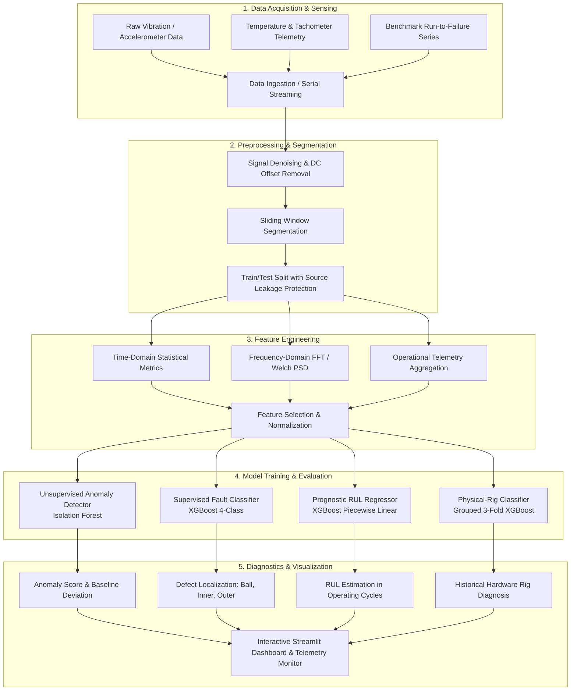

# Motor Bearing Predictive Maintenance
> An end-to-end machine learning framework for industrial motor bearing condition monitoring, fault diagnosis, and remaining useful life estimation.

## About the Project
Rolling element bearing degradation is one of the primary causes of unexpected downtime and catastrophic failures in rotating machinery. This project implements a multi-pillar predictive maintenance pipeline combining unsupervised anomaly detection, multi-class fault classification, and prognostic Remaining Useful Life (RUL) estimation. The system evaluates benchmark industrial datasets alongside an edge-level IoT telemetry DAQ prototype on physical motor hardware.

## Pipeline Flowchart



## Results Overview

| Pillar / Task | Dataset | Model / Algorithm | Metric 1 | Metric 2 | Metric 3 | Status |
| :--- | :--- | :--- | :--- | :--- | :--- | :---: |
| **Pillar 1: Anomaly Detection** | CWRU Drive-End (12 kHz) | Isolation Forest (300 Estimators) | Accuracy: 99.89% | Fault Recall: 100.00% | Specificity: 99.89% | Validated |
| **Pillar 2: Fault Classification** | CWRU Drive-End (12 kHz) | XGBoost Classifier (4-Class) | Test Accuracy: 98.57% | Grouped CV Acc: 99.06% ± 1.02% | Macro F1: 0.9856 | Validated |
| **Pillar 3: RUL Prognostics** | NASA C-MAPSS FD001 | XGBoost Regressor (Piecewise) | MAE: 14.2361 cycles | RMSE: 18.6810 cycles | $R^2$: 0.7979 | Validated |
| **Physical Rig Classification** | 9 ESP32 Motor Runs | XGBoost Classifier (32 Features) | Grouped 3-Fold CV: 78.43% | Test Accuracy: 78.43% | Majority Vote: 100% | Proof-of-Concept |

## Datasets

- **CWRU Bearing Dataset**:
  - Source: Case Western Reserve University Bearing Data Center
  - Sampling Rate: 12,000 samples/sec (Drive-End accelerometer)
  - Loads: 0, 1, 2, 3 HP motor operating loads
  - Fault Classes Covered: Normal baseline, Ball fault (0.007", 0.014", 0.021", 0.028"), Inner race fault (0.007", 0.014", 0.021", 0.028"), Outer race fault (centered @3, @6, @12 o'clock).
- **NASA C-MAPSS FD001**:
  - Source: NASA Prognostics Center of Excellence Turbofan Degradation Dataset
  - Size: 100 train engines (run-to-failure), 100 test engines (truncated degradation trajectories)
  - Channels: 21 sensor channels + 3 operational settings per engine cycle.
- **Physical Motor Rig Telemetry**:
  - Source: ESP32 microcontroller edge bench
  - Size: 9 experimental recording runs (810,000 raw samples total, 90,000 samples per 15-minute run)
  - Sampling Rate: 100 Hz
  - Conditions Covered: Normal operating baseline, Rotor mass imbalance, Shaft angular/parallel misalignment.

## Methodology

- **Signal Processing & Feature Extraction**:
  - Time-domain statistical features: Mean, standard deviation, RMS, peak-to-peak, crest factor, kurtosis, skewness, shape factor, impulse factor, clearance factor.
  - Spectral & frequency-domain features: Welch Power Spectral Density (PSD), Fast Fourier Transform (FFT) peak amplitudes, spectral centroid, spectral energy.
  - Operational metrics: Moving-average shaft rotational speed (RPM), surface bearing temperature trend (°C).
- **Machine Learning & Modeling**:
  - Unsupervised Anomaly Detection: Isolation Forest trained exclusively on healthy baseline vibration distributions.
  - Fault Classification: Multi-class Gradient Boosted Trees (XGBoost) with softmax objective.
  - RUL Prognostics: Piecewise linear-capped target degradation curve with XGBoost regression.
- **Validation Strategy & Leakage Protection**:
  - Source-signal grouped validation: Prevents sliding windows derived from the same source file/recording from leaking across training and evaluation splits.
  - 5-Fold GroupKFold cross-validation for CWRU benchmark.
  - 3-Fold recording-level cross-validation for physical rig experiments.

## Hardware

- **Microcontroller / DAQ Unit**: Espressif ESP32-WROOM-32 (Dual Core 240 MHz, FreeRTOS).
- **Vibration Sensor**: Analog Devices ADXL345 3-axis digital accelerometer (I2C interface, $\pm 16g$ dynamic range, 100 Hz output data rate).
- **Temperature Sensor**: Maxim Integrated DS18B20 1-Wire digital thermometer (surface probe on bearing housing).
- **Rotational Speed Sensor**: Hall-effect magnetic proximity sensor counting shaft rotation pulses for RPM calculation.
- **Serial Interface**: USB UART streaming ASCII CSV packets at 115,200 baud.
- **Motor / Rig Specs**: [TODO: add specific motor make, model, rated voltage, and operating power if required].

## Tech Stack

- **Core Language**: Python 3.10+, C++ (Arduino framework for ESP32)
- **Machine Learning**: `scikit-learn`, `xgboost`, `scipy`, `numpy`, `pandas`, `joblib`
- **Deep Learning (Exploratory)**: `tensorflow`
- **Visualization & UI**: `streamlit`, `plotly`, `matplotlib`
- **Hardware & Embedded**: `platformio`, `pyserial`

## Setup / How to Run

1. **Clone the repository**:
   ```bash
   git clone [TODO: insert repository URL]
   cd predictive_maintenance
   ```

2. **Set up Python Virtual Environment**:
   ```bash
   python -m venv .venv
   source .venv/bin/activate  # On Windows: .venv\Scripts\activate
   ```

3. **Install Dependencies**:
   ```bash
   pip install -r requirements.txt
   ```

4. **Launch the Interactive Dashboard**:
   ```bash
   streamlit run dashboard.py
   ```
   Open `http://localhost:8501` in your browser.

5. **(Optional) Run Machine Learning Reproducibility Scripts**:
   - CWRU Anomaly Detection: `python ml/fault_classification/cwru_anomaly_detection.py`
   - CWRU Fault Classification: `python ml/fault_classification/cwru_xgboost.py`
   - CWRU 5-Fold Cross-Validation: `python ml/fault_classification/cwru_cross_validation.py`
   - NASA FD001 RUL Regression: `python ml/rul_prediction/nasa_fd001_xgboost.py`
   - Physical Rig 32-Feature Training: `python scripts/train_physical_rig_model.py`

6. **(Optional) Live ESP32 Hardware Streaming**:
   - Connect the programmed ESP32 to a USB port.
   - In the Live Physical-Rig Monitor section of the dashboard, select the active COM port and click **Connect Serial** to monitor live RPM, Temperature, and Vibration magnitude.

## Repository Structure

```text
predictive_maintenance/
├── data/
│   ├── external/
│   │   ├── CWRU-dataset/              # Raw CWRU 12 kHz MATLAB vibration signals
│   │   └── nasa_cmapps/               # NASA C-MAPSS FD001 train, test, and RUL texts
│   ├── processed/                     # Validated evaluation CSVs and feature metadata
│   └── raw/                           # 9 historical physical-rig raw CSV recordings
├── include/
│   └── README                         # PlatformIO include scaffold
├── lib/
│   └── README                         # PlatformIO library scaffold
├── ml/
│   ├── fault_classification/          # CWRU anomaly detection, XGBoost, feature extraction
│   └── rul_prediction/                # NASA FD001 RUL regression & LSTM proxy scripts
├── models/
│   ├── cwru_anomaly_detector.pkl      # Trained Isolation Forest model
│   ├── cwru_xgboost.pkl               # Trained 4-class CWRU classifier
│   ├── lstm_proxy_rul.keras           # Exploratory negative-result model artifact
│   ├── nasa_fd001_xgboost.pkl         # Trained NASA FD001 RUL regressor
│   └── physical_rig_classifier.pkl    # Trained 32-feature physical-rig classifier
├── scripts/
│   ├── collect_data.py                # Serial logger for ESP32 raw capture
│   ├── prepare_physical_rig_previews.py # Waveform and Welch PSD spectra generator
│   └── train_physical_rig_model.py    # Physical-rig 32-feature extraction & grouped CV
├── src/
│   └── main.cpp                       # ESP32 FreeRTOS firmware source code
├── test/
│   └── README                         # PlatformIO test scaffold
├── .gitignore                         # Git exclusion rules (.venv, .pio, __pycache__)
├── dashboard.py                       # Main Streamlit presentation dashboard
├── platformio.ini                     # PlatformIO ESP32 configuration
├── README.md                          # Project documentation
└── requirements.txt                   # Pinned Python package dependencies
```
