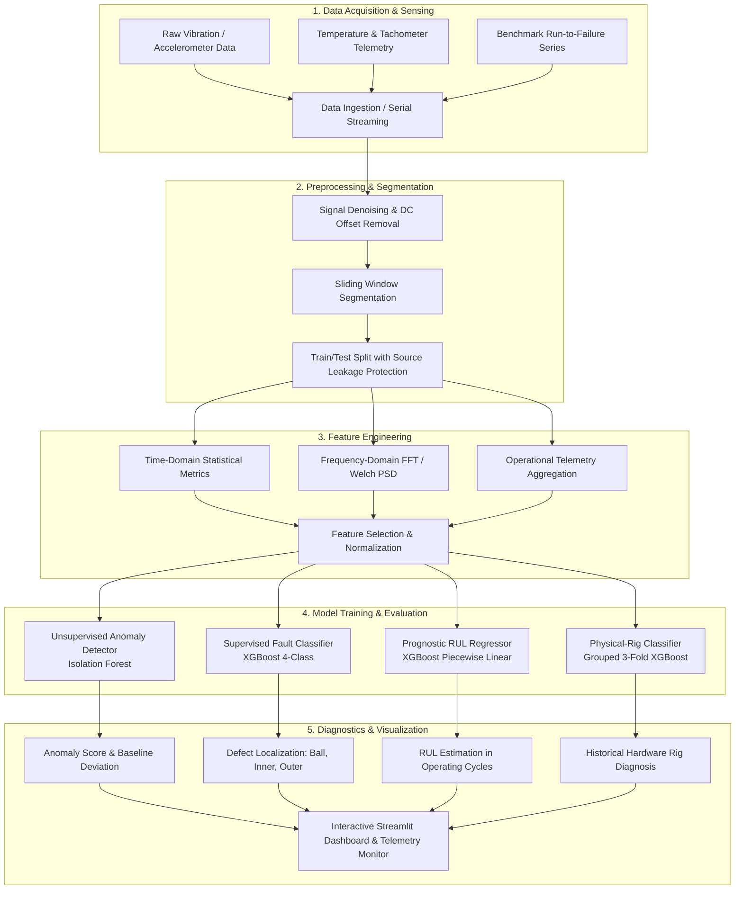

# Motor Bearing Predictive Maintenance

[](https://www.python.org/)
[](https://xgboost.ai/)
[](https://scikit-learn.org/)
[](https://streamlit.io/)
[](https://www.espressif.com/)
[](https://platformio.org/)

---

## About the Project

Rolling element bearing degradation is one of the primary causes of unexpected downtime, catastrophic damage, and costly maintenance in rotating machinery. Early detection of sub-surface micro-cracks and defect progression is essential for condition-based maintenance strategies.

This project implements a multi-pillar predictive maintenance architecture evaluated across standardized industrial benchmarks alongside a physical hardware prototype:

1. **Unsupervised Anomaly Detection (Pillar 1):** Detects early deviation from normal operating states without requiring prior fault signatures during training.
2. **Supervised Fault Classification (Pillar 2):** Diagnoses discrete defect categories (Ball, Inner Race, Outer Race) across multiple severity levels.
3. **Prognostic RUL Estimation (Pillar 3):** Forecasts remaining functional operating cycles on run-to-failure degradation trajectories.
4. **Physical-Rig Condition Analysis:** Evaluates a 32-feature machine learning classifier across 9 experimental motor runs.
5. **Edge IoT Data Acquisition (DAQ):** Streams real-time tri-axial vibration, surface bearing temperature, and shaft rotational speed from an ESP32 microcontroller into an interactive Streamlit diagnostics dashboard.

---

## Pipeline Architecture



---

## Results

Each analytical pillar addresses a distinct machine learning problem with its own dataset, feature representation, and evaluation protocol:

| Pillar / Task | Benchmark Dataset | Model / Algorithm | Primary Metric | Secondary Metric | Generalization Metric | Validation Status |
| :--- | :--- | :--- | :--- | :--- | :--- | :---: |
| **Pillar 1: Anomaly Detection** | CWRU Drive-End (12 kHz) | Isolation Forest (300 Estimators) | **Accuracy: 99.89%** | **Fault Recall: 100.00%** | **Specificity: 99.89%** | **Validated Benchmark** |
| **Pillar 2: Fault Classification** | CWRU Drive-End (12 kHz) | XGBoost Classifier (4-Class) | **Test Accuracy: 98.57%** | **Grouped CV: 99.06% ± 1.02%** | **Macro F1: 0.9856** | **Validated Benchmark** |
| **Pillar 3: RUL Prognostics** | NASA C-MAPSS FD001 | XGBoost Regressor (Piecewise) | **MAE: 14.2361 cycles** | **RMSE: 18.6810 cycles** | **R²: 0.7979** | **Validated Benchmark** |
| **Physical-Rig Classification** | 9 ESP32 Motor Runs | XGBoost Classifier (32 Features) | **Grouped 3-Fold CV: 78.43%** | **Test Accuracy: 78.43%** | **Majority Vote: 100%** | **Proof-of-Concept** |

> **Note on Physical-Rig Validation:** The physical-rig model is an experimental proof-of-concept trained on 9 real laboratory runs (810,000 samples). Its 78.43% accuracy reflects strict out-of-fold recording-level evaluation where the test run was entirely unseen during training.

---

## Datasets

### 1. Case Western Reserve University (CWRU) Bearing Dataset
* **Source:** Case Western Reserve University Bearing Data Center.
* **Sampling Rate:** 12,000 samples/sec (Drive-End accelerometer).
* **Operating Conditions:** Motor loads of 0, 1, 2, and 3 HP (approx. 1,797 to 1,720 RPM).
* **Fault Categories:**
  * Healthy baseline (Normal operating state).
  * Ball faults: 0.007", 0.014", 0.021", and 0.028" defect diameters.
  * Inner race faults: 0.007", 0.014", 0.021", and 0.028" defect diameters.
  * Outer race faults: 0.007", 0.014", and 0.021" defect diameters with faults centered at 3 o'clock (orthogonal), 6 o'clock (load zone), and 12 o'clock positions.
* **Role in Framework:** Serves as the primary standardized benchmark for vibration-based anomaly detection and supervised multi-class defect classification.

### 2. NASA C-MAPSS Turbofan Degradation (FD001)
* **Source:** NASA Prognostics Center of Excellence.
* **Scope:** 100 training turbofan engine units (run continuously until failure) and 100 test engine units (trajectories truncated prior to failure).
* **Channels:** 21 sensor measurements (temperatures, pressures, fan speeds) and 3 operational flight settings recorded per operating cycle.
* **Role in Framework:** Evaluates prognostic Remaining Useful Life (RUL) regression algorithms on multi-sensor degradation trajectories. *(Note: C-MAPSS is an aero-engine degradation dataset and is not a bearing vibration dataset; it is used exclusively to evaluate the prognostic RUL pillar).*

### 3. Physical Motor-Rig Telemetry Dataset
* **Source:** Custom ESP32-based desktop test bench.
* **Scale:** 9 experimental recording runs (810,000 raw samples total, 90,000 samples per 15-minute run).
* **Sampling Rate:** 100 Hz synchronized data stream.
* **Conditions Recorded:**
  * Normal Baseline (3 runs: `normal_01`, `normal_02`, `normal_03`).
  * Rotor Mass Imbalance (3 runs: `imbalance_01`, `imbalance_02`, `imbalance_03`).
  * Shaft Misalignment (3 runs: `misalignment_01`, `misalignment_02`, `misalignment_03`).
* **Role in Framework:** Demonstrates real-world edge data collection, hardware sensor integration, and recording-level grouped ML evaluation.

---

## Methodology

### Signal Processing & Feature Engineering
Vibration time series are segmented into discrete sliding windows (4,096 samples for 12 kHz CWRU; 100 samples / 1.0 s for 100 Hz physical rig). Features are extracted across three complementary domain representations:

1. **Time-Domain Statistical Metrics:**
   * *Mean & Standard Deviation:* Captures baseline signal shifts and dispersion.
   * *Root Mean Square (RMS) & Peak-to-Peak:* Quantifies total vibration energy and extreme shock amplitudes.
   * *Crest Factor, Kurtosis, & Skewness:* Highly sensitive indicators for early spalling and localized bearing impacts.
   * *Shape, Impulse, & Clearance Factors:* Dimensionless ratios designed to detect impulse degradation profiles before severe energy rises occur.
2. **Frequency-Domain Spectral Analysis:**
   * *Welch Power Spectral Density (PSD):* Averages modified periodograms to provide low-variance spectral density estimates across vibration frequencies.
   * *Fast Fourier Transform (FFT) Peak Amplitudes:* Identifies fundamental shaft rotational harmonics and characteristic defect frequencies.
   * *Spectral Centroid & Total Spectral Energy:* Monitors global distribution shifts from low-frequency unbalance toward high-frequency metal-to-metal rubbing.
3. **Operational Telemetry Aggregation:**
   * *Moving-Average Shaft RPM:* Tracks instantaneous rotational load variations.
   * *Surface Bearing Temperature Trend:* Monitors steady-state thermal equilibrium and friction-induced heating.

---

## Machine Learning Framework

### 1. Unsupervised Anomaly Detection (Pillar 1)
* **Algorithm:** Isolation Forest (300 estimators, 0.01 contamination).
* **Training Formulation:** Fitted strictly on healthy baseline Drive-End vibration signals (Loads 0, 1, 2 HP). Held-out load 3 HP and all fault signals are excluded during training.
* **Objective:** Isolates anomalies by measuring the average path length required to partition samples in random trees. Anomalous defect windows yield significantly shorter path lengths than the learned normal operating envelope.
* **Benchmark Result:** 99.89% window-level accuracy, 100.00% fault recall (1,741 / 1,741 fault windows detected), and 100.00% source-signal majority voting accuracy across 61 evaluated signals.

### 2. Multi-Class Bearing Fault Classification (Pillar 2)
* **Algorithm:** Multi-Class XGBoost Classifier (100 estimators, max depth 4, learning rate 0.08).
* **Target Classes:** 4 discrete conditions (`NORMAL`, `BALL`, `INNER_RACE`, `OUTER_RACE`).
* **Validation:** 5-Fold GroupKFold cross-validation across 65 unique source signals.
* **Benchmark Result:** 98.57% test accuracy on held-out source signals and $99.06\% \pm 1.02\%$ mean grouped cross-validation accuracy ($0.9856$ Macro F1).

### 3. Prognostic RUL Estimation (Pillar 3)
* **Algorithm:** XGBoost Regressor with piecewise linear target formulation.
* **Target Formulation:** Maximum RUL capped at 125 operating cycles to model the initial steady-state health phase where no measurable degradation has accumulated.
* **Benchmark Result:** Evaluated on 100 official held-out NASA test engines:
  * **Mean Absolute Error (MAE):** 14.2361 cycles
  * **Root Mean Squared Error (RMSE):** 18.6810 cycles
  * **Coefficient of Determination ($R^2$):** 0.7979
  * **Spearman Rank Correlation:** 0.8500 (confirming monotonic degradation tracking)

### 4. Physical-Rig Fault Classification
* **Algorithm:** XGBoost Classifier trained on 32 extracted statistical, spectral, and operational features.
* **Validation:** Strict 3-Fold recording-level cross-validation (Fold 1 tests `*_01`, Fold 2 tests `*_02`, Fold 3 tests `*_03`).
* **Experimental Result:** 78.43% grouped cross-validation accuracy (8,100 total out-of-fold windows) and 100% recording-level majority vote agreement across all 9 physical runs.

---

## Validation Strategy & Leakage Protection

In vibration time-series analysis, **random window-level shuffling causes severe data leakage** because adjacent sliding windows extracted from the same continuous recording share nearly identical time-frequency signatures. Random splitting inflates validation accuracy while masking complete failure on new physical recordings.

To guarantee rigorous, generalizable performance:
* **Source-Signal Grouping (CWRU):** Windowed samples from any given `.mat` recording are assigned exclusively to training, validation, or test folds. No individual recording is split across folds.
* **Recording-Level Grouping (Physical Rig):** Grouped 3-Fold evaluation ensures that an entire 15-minute motor run is evaluated against models trained solely on distinct motor runs.
* **Baseline Normal Isolation:** The unsupervised Isolation Forest is fitted on healthy baselines without exposure to fault data, simulating genuine zero-day anomaly detection.

---

## Hardware & Edge DAQ

### Embedded Hardware Architecture
* **Microcontroller Unit:** Espressif ESP32-WROOM-32 (Dual-Core Tensilica LX6 @ 240 MHz, FreeRTOS).
* **Vibration Accelerometer:** Analog Devices ADXL345 (3-axis digital sensor, I2C interface @ 400 kHz, $\pm 16g$ dynamic range, 100 Hz output data rate).
* **Temperature Sensor:** Maxim Integrated DS18B20 (1-Wire digital thermometer, probe mounted directly on bearing housing).
* **Rotational Speed Sensor:** Hall-effect magnetic proximity sensor counting shaft rotation pulses via hardware interrupt (FALLING edge on GPIO 5).
* **Data Transmission:** Formatted ASCII CSV serial packets over USB UART at **115,200 baud**:
  ```text
  timestamp_ms,temperature_C,accel_x,accel_y,accel_z,rpm
  1250,24.50,0.1250,-0.0450,9.8100,1450.0
  ```

### Motor Test Bench Specifications
* **Motor Make / Model:** `[TODO: Specify motor manufacturer, model number, rated power (W/HP), and operating voltage]`
* **Bearing Model:** `[TODO: Specify bearing model, pitch diameter, and ball count]`
* **Drive Configuration:** Direct-drive shaft coupling with mechanical imbalance disc and adjustable alignment mounts.

---

## Technology Stack

| Domain | Technologies & Libraries |
| :--- | :--- |
| **Core Languages** | Python 3.10+, C++ (Arduino Framework) |
| **Machine Learning** | `scikit-learn` (1.9.0), `xgboost` (3.4.1), `joblib` (1.5.3) |
| **Scientific Computing** | `numpy` (2.5.2), `pandas` (3.0.5), `scipy` (1.18.1) |
| **Deep Learning (Exploratory)** | `tensorflow` (2.21.0) |
| **UI & Visualization** | `streamlit` (1.62.0), `plotly` (7.0.0), `matplotlib` (3.11.1) |
| **Embedded & Hardware** | `platformio`, `pyserial` (3.5), `Adafruit_ADXL345`, `DallasTemperature` |

---

## Repository Structure

```text
predictive_maintenance/
├── data/
│   ├── external/
│   │   ├── CWRU-dataset/              # CWRU 12 kHz Drive-End MATLAB vibration signals
│   │   └── nasa_cmapps/               # NASA C-MAPSS FD001 train, test, and RUL texts
│   ├── processed/                     # Validated evaluation CSVs and feature metadata
│   └── raw/                           # 9 physical-rig raw CSV recordings (810,000 samples)
├── include/
│   └── README                         # PlatformIO include scaffold
├── lib/
│   └── README                         # PlatformIO library scaffold
├── ml/
│   ├── fault_classification/
│   │   ├── cwru_anomaly_detection.py  # Pillar 1 CWRU Isolation Forest pipeline
│   │   ├── cwru_xgboost.py            # Pillar 2 CWRU 4-class XGBoost pipeline
│   │   ├── cwru_cross_validation.py   # Pillar 2 5-fold source-grouped CV pipeline
│   │   ├── features.py                # 21-feature time/spectral feature extractor
│   │   ├── prepare_dataset.py         # CWRU MAT loader and window segmenter
│   │   ├── split_dataset.py           # Leakage-safe train/test partition script
│   │   ├── train_model.py             # Baseline fault classifier
│   │   ├── analyze_errors.py          # Error diagnostic script
│   │   ├── anomaly_detection.py       # Prototype anomaly detector
│   │   └── health_score.py            # Prototype health indexer
│   └── rul_prediction/
│       ├── nasa_fd001_xgboost.py      # Pillar 3 NASA FD001 RUL regression pipeline
│       └── proxy_rul_lstm.py          # Exploratory LSTM proxy RUL script
├── models/
│   ├── cwru_anomaly_detector.pkl      # Pillar 1 trained Isolation Forest artifact
│   ├── cwru_xgboost.pkl               # Pillar 2 trained 4-class XGBoost artifact
│   ├── lstm_proxy_rul.keras           # Exploratory negative-result LSTM artifact
│   ├── nasa_fd001_xgboost.pkl         # Pillar 3 trained NASA FD001 RUL artifact
│   └── physical_rig_classifier.pkl    # Historical physical-rig 32-feature XGBoost artifact
├── project_photos/                    # Dashboard previews and test bench photos
├── scripts/
│   ├── collect_data.py                # UART serial data logger for ESP32 raw capture
│   ├── prepare_physical_rig_previews.py # Waveform and Welch PSD spectra generator
│   └── train_physical_rig_model.py    # 32-feature extraction & grouped 3-fold CV pipeline
├── src/
│   └── main.cpp                       # ESP32 FreeRTOS firmware source code
├── test/
│   └── README                         # PlatformIO test scaffold
├── .gitignore                         # Version control exclusions (.venv, .pio, __pycache__)
├── dashboard.py                       # Main Streamlit presentation dashboard
├── platformio.ini                     # PlatformIO ESP32 build configuration
├── README.md                          # Project documentation
└── requirements.txt                   # Pinned Python package dependencies
```

---

## Setup & Quick Start

### 1. Clone & Set Up Python Environment
```bash
# Clone the repository
git clone https://github.com/premkumarrs/motor-bearing-predictive-maintenance.git
cd motor-bearing-predictive-maintenance

# Create and activate virtual environment
python -m venv .venv
source .venv/bin/activate  # On Windows: .venv\Scripts\activate

# Install exact pinned dependencies
pip install -r requirements.txt
```

### 2. Launch the Research Dashboard
```bash
streamlit run dashboard.py
```
Open `http://localhost:8501` in your browser. The dashboard runs offline using pre-evaluated cached artifacts for instantaneous rendering.

---

## Reproducing Machine Learning Pipelines

All benchmark models, evaluation metrics, and feature tables can be regenerated from source data using the verified pipeline scripts:

```bash
# 1. Train & evaluate Pillar 1 (CWRU Anomaly Detection)
python ml/fault_classification/cwru_anomaly_detection.py

# 2. Train & evaluate Pillar 2 (CWRU Supervised Fault Classification)
python ml/fault_classification/cwru_xgboost.py
python ml/fault_classification/cwru_cross_validation.py

# 3. Train & evaluate Pillar 3 (NASA C-MAPSS FD001 RUL Prognostics)
python ml/rul_prediction/nasa_fd001_xgboost.py

# 4. Extract 32 features & run Grouped 3-Fold CV for Physical Rig
python scripts/train_physical_rig_model.py
python scripts/prepare_physical_rig_previews.py
```

---

## License

**MIT License**
