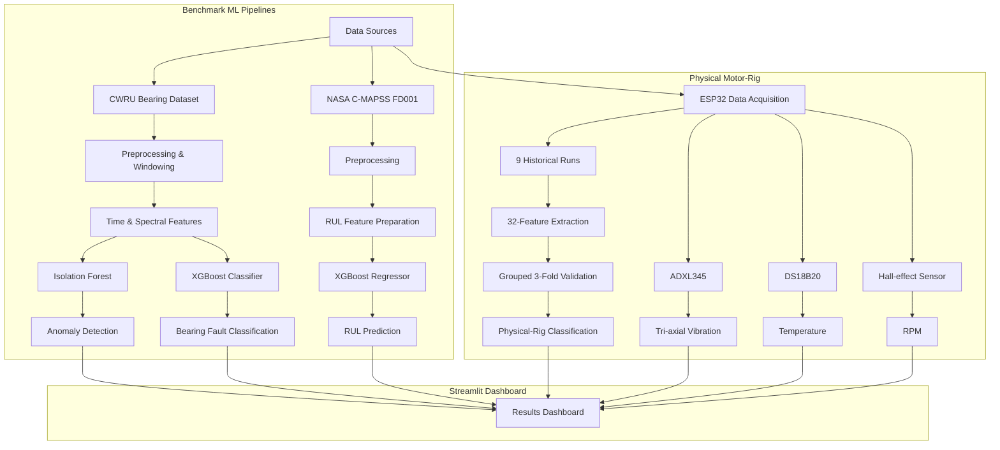

# Motor Bearing Predictive Maintenance

[](https://www.python.org/)
[](https://xgboost.ai/)
[](https://scikit-learn.org/)
[](https://streamlit.io/)
[](https://www.espressif.com/)
[](https://platformio.org/)

## About the Project

Motor Bearing Predictive Maintenance is a machine-learning project for motor bearing condition monitoring, fault diagnosis, and remaining useful life (RUL) estimation.

The project combines three benchmark ML pipelines with an experimental physical motor-rig system: CWRU bearing anomaly detection, CWRU bearing fault classification, NASA C-MAPSS FD001 RUL prediction, and ESP32-based vibration, temperature, and RPM data acquisition.

The physical motor-rig component is a proof-of-concept based on nine historical recordings. Its live dashboard monitor displays raw hardware telemetry and is separate from the benchmark ML inference pipelines.

## Pipeline Flowchart



## Results Overview

| Task | Model | Result |
|---|---|---|
| CWRU Anomaly Detection | Isolation Forest | 99.89% Accuracy |
| CWRU Bearing Fault Classification | XGBoost Classifier | 98.57% Test Accuracy |
| NASA FD001 RUL Prediction | XGBoost Regressor | MAE: 14.2361 cycles |
| Physical-Rig Condition Classification | XGBoost Classifier | 78.43% Grouped 3-Fold Accuracy |

The physical-rig result is an experimental proof-of-concept based on nine recorded motor-rig runs.

## Datasets

### 📊 CWRU Bearing Dataset

Used for:
- Anomaly detection
- 4-class bearing fault classification

### ✈️ NASA C-MAPSS FD001

Used for:
- Remaining useful life (RUL) prediction

### ⚙️ Physical Motor-Rig Dataset

Contains:
- 9 historical recordings
  - 3 Normal
  - 3 Imbalance
  - 3 Misalignment
- 100 Hz sampling
- Vibration, temperature, and RPM measurements

The physical-rig recordings are experimental proof-of-concept data.

## Methodology

- Data preprocessing and signal/window segmentation
- Time-domain and spectral feature extraction
- Model-specific training
- Source/group-level separation where applicable
- Independent evaluation
- Results presented through the Streamlit dashboard

## Models

- Isolation Forest — CWRU anomaly detection
- XGBoost classifier — CWRU bearing fault classification
- XGBoost regressor — NASA FD001 RUL prediction
- XGBoost classifier — experimental physical-rig classification

Source-level and group-level separation are used where applicable to reduce leakage between related windows and signals.

## Hardware

### 🔧 Components

- ESP32 — edge data acquisition
- ADXL345 — tri-axial accelerometer for vibration measurement
- DS18B20 — temperature sensor
- Hall-effect sensor — RPM measurement

The ESP32 streams raw telemetry to the Streamlit dashboard over USB serial.

The live monitor displays raw RPM, temperature, and vibration telemetry. It does not perform live ML inference.

## Tech Stack

### 💻 Software

- Python
- NumPy
- Pandas
- SciPy
- scikit-learn
- XGBoost
- Streamlit
- Plotly
- Matplotlib
- Joblib
- TensorFlow

### 🔧 Embedded

- ESP32
- C++
- PlatformIO
- ADXL345
- DS18B20
- Hall-effect sensor
- pySerial

## Setup / How to Run

### 🐍 Python Environment

Clone the repository:

```
git clone https://github.com/premkumarrs/motor-bearing-predictive-maintenance.git
cd motor-bearing-predictive-maintenance
```

Create a virtual environment:

```
python -m venv .venv
```

Windows:

```
.venv\Scripts\activate
```

Linux/macOS:

```
source .venv/bin/activate
```

Install dependencies:

```
pip install -r requirements.txt
```

### ▶️ Run the Dashboard

```
streamlit run dashboard.py
```

Open:

```
http://localhost:8501
```

### 🔌 ESP32 Hardware

- Flash the firmware in `src/main.cpp` using PlatformIO.
- Connect the ESP32 through USB.
- Select the active serial port in the dashboard.
- The live monitor displays RPM, temperature, and vibration telemetry.

## Repository Structure

```
motor-bearing-predictive-maintenance/
├── data/
│   ├── external/       # CWRU and NASA datasets
│   ├── processed/      # Processed evaluation artifacts
│   └── raw/            # Physical motor-rig recordings
├── ml/
│   ├── fault_classification/
│   └── rul_prediction/
├── models/              # Trained ML model artifacts
├── scripts/             # Data collection and processing scripts
├── src/                 # ESP32 firmware
├── project_photos/      # Dashboard and hardware images
├── include/             # PlatformIO include scaffold
├── lib/                 # PlatformIO library scaffold
├── test/                # PlatformIO test scaffold
├── dashboard.py         # Streamlit dashboard
├── platformio.ini       # ESP32 / PlatformIO configuration
├── requirements.txt     # Python dependencies
├── README.md
└── .gitignore
```
